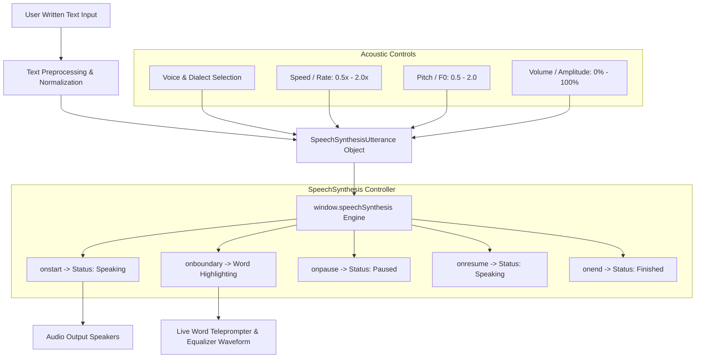

# SpeakText – Text to Speech Analyzer

> **College Text and Speech Analysis Laboratory**  
> **Course:** Text and Speech Analysis  
> **Experiment 07:** Text-to-Speech (Acoustic Speech Synthesis)


---

## 🎯 Objective

To convert written text into natural synthesized spoken audio in real time using the browser's native **Web Speech API (`SpeechSynthesis` & `SpeechSynthesisUtterance`)**, inspect vocal tract acoustic properties (speed, pitch, volume, locale, and dialect), and analyze the linguistic-to-acoustic pipeline without any external backend servers or third-party paid API keys.

---

## 🛠️ Technology Stack

- **HTML5:** Semantic architecture, accessible ARIA attributes, structured form controls, and responsive layout.
- **Vanilla CSS3:** Modern dark laboratory theme, glassmorphic cards, responsive grid, dynamic audio equalizer animation, glowing status badges, and custom styled slider components.
- **Vanilla JavaScript (ES6+):** Pure client-side orchestration, asynchronous voice loading and filtering, event-driven state machine (`Ready`, `Speaking`, `Paused`, `Finished`), real-time word boundary teleprompter tracking, and a Chromium 14-second speech keep-alive timer fix.
- **Browser Web Speech API:** Client-side speech synthesis pipeline communicating directly with OS native speech engines (Microsoft SAPI/Natural Voices, Google TTS, Apple Speech Manager, Android TTS).
- **Zero External Dependencies / No Backend:** Runs 100% in the user's local web browser with zero server round-trips and complete privacy.

---

## 🖥️ System Architecture & Workflow



---

## ✨ Features & Interface

### 1. Large Speech Buffer
- **Textarea:** Dedicated high-contrast input area with placeholder:
  > *“Type something you want the computer to speak...”*
- **Live Metrics Counter:** Real-time character count, word count, and estimated spoken reading duration (dynamically calculated based on words-per-minute and selected speech speed).
- **Keyboard Shortcuts:** Press <kbd>Ctrl</kbd> + <kbd>Enter</kbd> to immediately trigger speech, and <kbd>Esc</kbd> to stop.

### 2. Acoustic Parameter Controls
- **Voice Selection:** Automatically populates system voices provided by the host operating system and browser engines. Displays voice name, language locale (e.g. `en-US`), and engine type (Local vs Network/Cloud).
- **Language Filter:** Groups and filters available voices by language family (English, Spanish, French, German, Hindi, Japanese, Chinese, etc.).
- **Voice Name Search:** Quick live filter box to find specific voice personas (e.g. *David*, *Google*, *Jenny*, *Natural*).
- **Speech Speed (Rate):** Granular slider from `0.5x` (Slow) to `2.0x` (Fast), with default at `1.0x` (Normal).
- **Pitch (Fundamental Frequency $F_0$):** Slider from `0.5` (Deep vocal tract) to `2.0` (High pitch), with default at `1.0` (Natural).
- **Volume (Amplitude):** Slider from `0%` (Mute) to `100%` (Full volume), with real-time percentage display.
- **Reset Controls:** One-click button restoring default acoustic baseline settings (`1.0x` / `1.0` / `100%`).

### 3. Complete Playback Controls
- 🔊 **Speak:** Synthesizes the text buffer into human speech.
- ⏸ **Pause:** Suspends ongoing speech audio without losing speech buffer position.
- ▶ **Resume:** Resumes paused speech from the exact interruption point.
- ⏹ **Stop:** Halts playback, cancels speech synthesis queues, and resets status.
- 🗑 **Clear:** Clears both the active text buffer and resets speech engine state.

### 4. Speech Status State Machine
Displays real-time status badges with distinctive visual indications:
- 🟢 **Ready:** Engine initialized and awaiting input.
- 🔊 **Speaking:** Active speech synthesis with animated pulsing radar and wave equalizer.
- ⏸ **Paused:** Playback suspended by user.
- ✅ **Finished:** Utterance concluded naturally.

### 5. Acoustic Waveform Visualizer & Teleprompter
- **Equalizer Monitor:** 24-channel simulated frequency bar monitor that bounces dynamically during speech, freezes on pause, and returns to baseline when idle.
- **Real-Time Word Boundary Teleprompter:** Tracks `utterance.onboundary` events to highlight each word in real-time karaoke style as it is pronounced by the voice synthesizer.

---

## 🧪 Laboratory Demonstration Example

### Required Input Phrase:
```text
“Welcome to our Text and Speech Analysis project.”
```

### Procedure:
1. Click the **“Load & Speak Example”** button or select the target chip from the presets row.
2. The phrase is loaded into the speech buffer.
3. Click **🔊 Speak**.
4. The browser invokes `SpeechSynthesis` and reads the text aloud using the currently selected voice.
5. The status transitions to **Speaking**, the equalizer bars animate, and the active word display updates synchronously.

---

## 📚 Theory & Mathematical Concepts

### Fundamental Definition
> *“Text-to-speech is a technology that converts written text into synthesized human speech.”*

### The 4-Stage TTS Architecture

#### 1. Text Normalization (NLP Frontend)
Converts raw non-standard written text into unambiguous spoken words:
- **Numbers & Dates:** "2026" $\rightarrow$ *"twenty twenty-six"*, "$45.50" $\rightarrow$ *"forty-five dollars and fifty cents"*.
- **Abbreviations & Acronyms:** Differentiates abbreviations by syntactic context (e.g., *"Dr."* $\rightarrow$ *"Doctor"* vs *"Drive"*).
- **Punctuation Parsing:** Converts commas, semicolons, and periods into acoustic boundary pauses.

#### 2. Grapheme-to-Phoneme (G2P) Conversion
Transforms written orthographic letters into phonetic phonetic symbols (e.g., International Phonetic Alphabet / IPA or Arpabet):
$$\text{Graphemes: "analysis"} \xrightarrow{\text{G2P}} \text{Phonemes: /əˈnæl.ə.sɪs/}$$
Resolves homograph ambiguity where words share spelling but differ in pronunciation and meaning (e.g., *"lead"* [lɛd] vs *"lead"* [liːd]).

#### 3. Prosodic & Intonation Modeling
Generates natural rhythm, stress, and melodic contour:
- **Fundamental Frequency ($F_0$):** Governs vocal cord vibration rate (perceived as pitch).
- **Phoneme Durations:** Computes length in milliseconds for each vowel and consonant.
- **Stress & Prominence:** Enhances pitch and amplitude on emphasized syllables.

#### 4. Acoustic Synthesis & Vocoders
Synthesizes the physical analog audio pressure waves:
- **Concatenative Synthesis:** Assembles pre-recorded human speech units (diphones, syllables) using unit-selection algorithms.
- **Formant Synthesis:** Generates synthetic speech mathematically through a series of resonant frequency bandpass filters modeling human vocal tract formants ($F_1, F_2, F_3$).
- **Neural Vocoders (Deep Learning):** Generative autoregressive or diffusion models (e.g., WaveNet, Tacotron 2, FastSpeech, HiFi-GAN) that synthesize high-fidelity raw 24kHz/48kHz audio directly from Mel-spectrograms.

---

## 🌐 Web Speech API Lifecycle

```javascript
// 1. Initialize controller
const synth = window.speechSynthesis;

// 2. Instantiate utterance with input text
const utterance = new SpeechSynthesisUtterance("Welcome to our Text and Speech Analysis project.");

// 3. Configure voice and parameters
utterance.voice = synth.getVoices()[0];
utterance.rate = 1.0;   // Speed: 0.1 to 10
utterance.pitch = 1.0;  // Pitch: 0 to 2
utterance.volume = 1.0; // Volume: 0 to 1

// 4. Attach event listeners
utterance.onstart = () => console.log("Speech started");
utterance.onboundary = (e) => console.log("Spoken word offset:", e.charIndex);
utterance.onend = () => console.log("Speech finished");

// 5. Dispatch to synthesis audio pipeline
synth.speak(utterance);
```

### The Chrome Long-Speech Keep-Alive Bug Fix
Chromium-based browsers have a documented issue where speech utterances longer than ~14 seconds can pause silently due to internal garbage collection. SpeakText resolves this using a keep-alive pulse:
```javascript
function startKeepAlive() {
  setInterval(() => {
    if (speechSynthesis.speaking && !speechSynthesis.paused) {
      speechSynthesis.pause();
      speechSynthesis.resume();
    }
  }, 10000);
}
```

---

## 🚀 How to Run Locally

Because this project is built entirely on native web standards (HTML5, CSS3, ES6 JavaScript) with zero dependencies:

1. Clone or download this repository:
   ```bash
   git clone https://github.com/kameshpa7-hash/TSA7.git
   cd TSA7
   ```
2. Open `index.html` in any modern web browser:
   - **Google Chrome** (Recommended)
   - **Microsoft Edge** (Recommended, includes high-definition Natural voices)
   - **Apple Safari** (macOS / iOS)
   - **Mozilla Firefox**
3. Or serve using any lightweight static server:
   ```bash
   # Python 3
   python -m http.server 3000
   
   # Node npx
   npx serve .
   ```

---

## 📋 Experiment Evaluation Checklist

| Requirement | Implementation Details | Status |
| :--- | :--- | :---: |
| **Header** | `TEXT & SPEECH ANALYSIS` & `Experiment 07 — Text-to-Speech` | ✅ |
| **Large Textarea** | `Type something you want the computer to speak...` with metrics | ✅ |
| **Voice Selection** | Auto-populated via `speechSynthesis.getVoices()` & `onvoiceschanged` | ✅ |
| **Language Selection** | Language group filter and dialect selector | ✅ |
| **Speech Speed** | Granular rate slider (0.5x – 2.0x) with real-time value badge | ✅ |
| **Pitch Control** | Slider (0.5 – 2.0) with real-time value badge | ✅ |
| **Volume Control** | Slider (0% – 100%) with real-time percentage badge | ✅ |
| **Playback Buttons** | 🔊 Speak, ⏸ Pause, ▶ Resume, ⏹ Stop, 🗑 Clear | ✅ |
| **Speech Status** | Distinct badges for `Ready`, `Speaking`, `Paused`, `Finished` | ✅ |
| **Selected Voice Info**| Details card showing voice name, language code, and engine | ✅ |
| **Required Example** | Preset chip & 1-click button for *"Welcome to our Text and Speech Analysis project."* | ✅ |
| **Explanation** | Prominent explanation of *"Text-to-speech is a technology that converts written text into synthesized human speech."* + 4-stage pipeline | ✅ |

---

## 👨‍💻 Laboratory Information

- **Institution:** Department of Computer Science & Engineering
- **Laboratory:** Text and Speech Analysis Laboratory
- **Experiment:** Experiment 07 — Text-to-Speech Synthesis
- **Target Git Repository:** [https://github.com/kameshpa7-hash/TSA7.git](https://github.com/kameshpa7-hash/TSA7.git)
